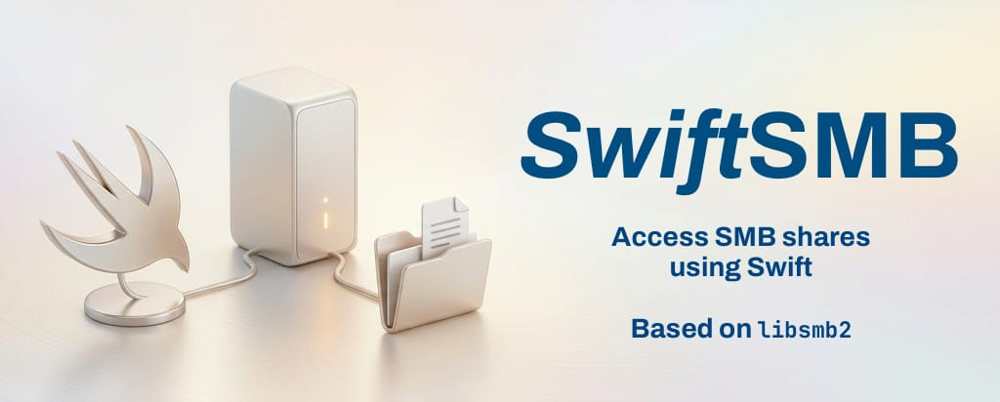

# SwiftSMB

[](LICENSE)
[](https://swiftpackageindex.com/RuiNelson/SwiftSMB)

[](https://swiftpackageindex.com/RuiNelson/SwiftSMB)

[](https://swift.org/package-manager/)
[](https://github.com/RuiNelson/SwiftSMB/releases)
[](https://github.com/RuiNelson/SwiftSMB/actions/workflows/apple.yml)
[](https://github.com/RuiNelson/SwiftSMB/actions/workflows/linux.yml)
[](https://github.com/RuiNelson/SwiftSMB/actions/workflows/android.yml)



SwiftSMB is a Swift Package Manager library for talking to SMB2 and SMB3 file shares from Swift. It wraps the proven [`libsmb2`](https://github.com/sahlberg/libsmb2) client library in a Swift-first API with typed configuration, friendly path handling, file and directory handles, share discovery, metadata operations, and convenience helpers for common upload and download workflows.

Use it when your app or service needs to browse Windows, Samba, NAS, or other SMB-compatible shares without shelling out to system tools.

## Cookbook

The examples below list shares and transfer local files through an SMB share. Every operation that talks to the server
is `async`, so call them from an asynchronous context with `try await`:

```swift
import Foundation
import SwiftSMB

let server = SMB.Server(host: "RASPBERRYPI.local") // IP or hostname
let credentials = SMB.Credentials(user: "Anna", password: "1987")
```

### Listing shares

`listShares(server:credentials:...)` connects to the server, asks it for its disk shares, and disconnects before returning:

```swift
let shares = try await SMB.listShares(
    server: server,
    credentials: credentials
)

for share in shares {
    print(share.name)
}
```

By default, hidden shares are filtered out. Pass `includeHidden: true` if you need to inspect them too.

### Connecting to a share

Use one of the returned share names to open a connection:

```swift
let connection = try await SMB.connect(
    server: server,
    credentials: credentials,
    share: "Documents"
)
defer { try? await connection.disconnect() }

let serverID: UUID = try await connection.serverGUID
```

Operations on a connection run one at a time, in the order they were requested. Open separate connections to run
operations in parallel. `fork()` opens another connection to the same share, with the same credentials and
configuration:

```swift
let secondConnection = try await connection.fork()
defer { try? await secondConnection.disconnect() }
```

A fork reads and writes in the block sizes the server accepted for the original connection, rather than the configured
`transferBlockSize`, and starts with its current command timeout.

Set a command timeout when connecting if you want `libsmb2` to abort operations that take too long:

```swift
let connection = try await SMB.connect(
    server: server,
    credentials: credentials,
    share: "Documents",
    configuration: SMB.Configuration(timeout: 30)
)
```

Establishing the connection always has a deadline: the configured timeout when it is positive, otherwise 30 seconds.

You can also change the timeout for subsequent operations on an existing connection:

```swift
try await connection.setTimeout(10)
try await connection.setTimeout(0) // Disable command timeouts
```

Encryption has three explicit policies: `.automatic` advertises support and uses encryption when required by the
server or share, `.disabled` suppresses encryption, and `.required` fails unless encryption is negotiated:

```swift
let configuration = SMB.Configuration(encryption: .required)
```

### Listing a directory

`listDirectory(at:)` returns an array with the entries in a directory:

```swift
let entries = try await connection.listDirectory(at: "Anna/Inbox")
```

In this library, just like `libsmb2` uses forward slash for separating directories. You don't need to add "/" to indicate the root of the file share.

### uploadFile

`uploadFile(local:remote:...)` copies a local file to the connected share. It can create missing parent directories and, by default, stages the upload through a temporary remote file before renaming it into place:

```swift
let localURL = URL(fileURLWithPath: "/Users/Anna/Desktop/report.pdf")

try await connection.uploadFile(
    local: localURL,
    remote: "Anna/Inbox/report.pdf"
) { completed, total, lastBlockSpeed, averageSpeedSinceTheStartOfTheTransfer in
    let speed = 0.5 * lastBlockSpeed + 0.5 * averageSpeedSinceTheStartOfTheTransfer
    print("Uploaded \(completed) of \(total) bytes at \(round(speed/1000.0)) kB/s")
    return true
}
```

Return `false` from the progress closure to cancel the upload. Cancelling the task that runs the upload also stops it,
and the call then throws `CancellationError`.

### downloadFile

`downloadFile(remote:local:...)` copies a file from the connected share to local storage. The download is written to a temporary local file first and then moved into place after the transfer succeeds:

```swift
let localURL = URL(fileURLWithPath: "/Users/alice/Downloads/report.pdf")

try await connection.downloadFile(
    remote: "Anna/Inbox/report.pdf",
    local: localURL
) { completed, total, latestSpeed, averageSpeed in
    print("Downloaded \(completed) of \(total) bytes")
    return true
}
```

Return `false` from the progress closure to cancel the download. Cancelling the task that runs the download also stops
it, and the call then throws `CancellationError`.

Both methods also accept a progress closure that uses `await` (`SMB.Connection.AsyncFileProgress`), for example to
report progress to an actor. The transfer waits for it before moving on to the next block.

To transfer without a local file, `streamToRemote(remote:stream:...)` uploads the contents of an `InputStream` and
`streamFromRemote(remote:stream:...)` downloads into an `OutputStream`. See
[Uploads and Downloads](docs/uploads-downloads.md#streaming-to-and-from-the-share).

### Playing videos with AVPlayer

The `SwiftSMBAVFoundation` product streams media files from the share into AVFoundation, reading only the byte ranges
the player asks for:

```swift
import AVFoundation
import SwiftSMBAVFoundation

let player = AVPlayer(playerItem: connection.makePlayerItem(at: "Videos/holiday.mp4"))
player.play()
```

See [Playing media with AVFoundation](docs/video-playback.md).

### Reading and editing image metadata

The `SwiftSMBEXIFKit` product reads the EXIF of images on the share with
[EXIFKit](https://github.com/RuiNelson/EXIFKit), fetching only the byte ranges that hold metadata instead of the whole
image:

```swift
import SwiftSMBEXIFKit // Re-exports EXIFKit.
import UIKit

let metadata = try await connection.imageMetadata(at: "Photos/IMG_0001.JPG")
print(metadata.make, metadata.dateTimeOriginal)

if let data = try await metadata.readThumbnail(), let thumbnail = UIImage(data: data) {
    imageView.image = thumbnail
}
```

To edit or remove metadata, see [Reading and editing image metadata](docs/image-metadata.md).

### More advanced cookbooks

Longer examples belong in `docs/`:

- [File Management](docs/file-management.md)
- [Using convenience methods for uploads/downloads](docs/uploads-downloads.md)
- [Working with file handles and directory handles](docs/handles.md)
- [Changing properties of files](docs/file-properties.md)
- [Watching file system changes](docs/watching-changes.md)
- [Playing media with AVFoundation](docs/video-playback.md)
- [Reading and editing image metadata](docs/image-metadata.md)

## Adding this package to your Project

### Swift Package Manager (Package.swift)

Add SwiftSMB to your package dependencies:

```swift
dependencies: [
    .package(url: "https://github.com/RuiNelson/SwiftSMB.git", from: "3.0.0"),
]
```

Then add `SwiftSMB` to the target that uses it:

```swift
.target(
    name: "YourTarget",
    dependencies: [
        .product(name: "SwiftSMB", package: "SwiftSMB"),
    ]
)
```

To play media with AVFoundation, also add `.product(name: "SwiftSMBAVFoundation", package: "SwiftSMB")`. To read and
edit image metadata, also add `.product(name: "SwiftSMBEXIFKit", package: "SwiftSMB")`.

SwiftSMB currently declares support for macOS 10.15.4+, iOS 13.4+, macCatalyst 13.4+, tvOS 13.4+, visionOS 1+, and watchOS 6.2+. It also builds for Linux and Android (aarch64, API 28+). The package uses Swift tools version 6.2.

### Xcode Project

1. Open your project in Xcode.
2. Choose **File -> Add Package Dependencies...**.
3. Enter `https://github.com/RuiNelson/SwiftSMB.git`.
4. Choose the version rule you want to use.
5. Add the `SwiftSMB` product to your app or framework target.
6. Import the library where you need it:

```swift
import SwiftSMB
```

## Building

### Command Line

Just enter:

```bash
swift build
```

Some tests are integration tests and expect the Docker-based Samba test server to be running:

```bash
docker ps --filter ancestor=swiftsmb-test-server
source TestServer/up.sh
swift test
```

## Licensing

SwiftSMB is distributed under the Apache License, version 2.0. A copy of the license is included in [LICENSE](LICENSE).

The bundled [`libsmb2`](https://github.com/sahlberg/libsmb2) sources keep their own license, the GNU Lesser General Public License, version 2.1. If you distribute an app or product that links with SwiftSMB/libsmb2, make sure you preserve license notices, provide access to the LGPL-covered `libsmb2` source, and allow users to replace or relink the LGPL-covered library as required by that license.

To help with that last requirement, `Package.swift` declares `libsmb2` as a dynamic library product (`.library(name: "libsmb2", type: .dynamic, ...)`), so the LGPL-covered code is linked dynamically and ships as a separate, replaceable binary instead of being statically absorbed into your app.

This section is only a project summary, not legal advice. Review the Apache 2.0 and LGPL v2.1 terms for your distribution model.
