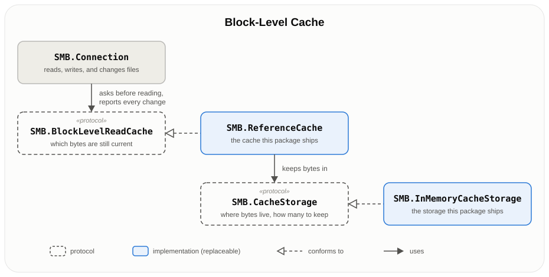

# Block-Level Cache

SwiftSMB can keep what a connection reads from the share so that reading it again costs nothing. This cookbook walks you
from adding a cache in two lines to replacing parts of it with your own. For the exact contract of each type and
method, see the symbol documentation in the source.

All examples assume you already have an open ``SMB.Connection``:

```swift
let server = SMB.Server(host: "RASPBERRYPI.local")
let credentials = SMB.Credentials(user: "Anna", password: "1987")
let connection = try await SMB.connect(server: server, credentials: credentials, share: "Photos")
defer { try? await connection.disconnect() }
```

## Table of Contents

1. [Getting started](#getting-started)
2. [How the cache APIs are organized](#how-the-cache-apis-are-organized)
3. [A custom storage backend for `ReferenceCache`](#a-custom-storage-backend-for-referencecache)
4. [A custom cache](#a-custom-cache)

---

## Getting started

Every time you read from a file on the share, the bytes cross the network. If your app reads the same bytes again — a
photo browser revisiting thumbnails, a player seeking back, a file you check right after uploading it — a cache lets the
connection answer from memory instead.

### Adding an in-memory cache

Create an ``SMB.ReferenceCache`` and attach it to a connection:

```swift
import SwiftSMB

let cache = SMB.ReferenceCache(configuration: .init())
connection.attachCache(cache)
```

Nothing else changes in your code. Files you open with ``SMB.Connection.openFile(at:accessMode:options:opLock:)``,
`uploadFile` and `downloadFile`, `loadFile`, `streamToRemote` and `streamFromRemote`, `compareFiles`, and the
AVFoundation and EXIFKit integrations all go through the cache from now on: reads ask it first, and what is written is
handed to it. The first read of a range comes from the
server; later reads of the same range come from memory.

With the default configuration the cache:

- keeps up to 256 MiB of file contents, dropping the least recently used files when it needs room, and, on Apple
  platforms, gives memory back when the system runs short;
- keeps what you write, so reading it back is free;
- forgets a file as soon as it changes through the connection — a write, rename, delete, truncation, change of
  timestamps, attributes or security descriptor, or server-side copy onto it — and notices changes made by others the
  next time the file is opened.

A cache never makes an operation fail. If it has nothing, or runs into trouble, the connection simply reads from the
server.

### What a cache costs

While a cache is attached, the connection makes two extra round trips the cache needs to tell file versions apart:

- opening a file for reading (``SMB.File.AccessMode.readOnly`` or ``SMB.File.AccessMode.readWrite``) also stats it, so
  the cache can tell whether the blocks it holds belong to the file now at that path;
- closing a file you wrote to stats it first, so the cache learns which version of the file the written blocks belong
  to.

A connection without a cache attached makes neither.

Stats and directory listings go to the server as before. ``SMB.Connection.stat(at:)``,
``SMB.Connection.itemExists(at:)``, and ``SMB.Connection.listDirectory(at:)`` consult the cache first, but the default
configuration never answers them; see [the metadata policy](#a-configured-cache-with-a-control-connection) below.
Directories read through an ``SMB.Directory`` handle never use the cache.

### Choosing how much to keep

To change the memory budget, give the cache its own storage:

```swift
let storage = SMB.InMemoryCacheStorage(byteBudget: 64 * 1024 * 1024)
let cache = SMB.ReferenceCache(storage: storage, configuration: .init())
```

``SMB.InMemoryCacheStorage`` also takes a `maximumFileSize`, so that one large video cannot push everything else out:

```swift
let storage = SMB.InMemoryCacheStorage(byteBudget: 256 * 1024 * 1024, maximumFileSize: 32 * 1024 * 1024)
```

The storage keeps whole files only: to stay within its budget it drops the least recently used files, never parts of
them. On Apple platforms it drops files when the system runs short of memory: down to half the budget on a warning, and
everything when memory is critical.

### Forks, several shares, and closing

``SMB.Connection.fork()`` passes the attached cache on: connections forked while a cache is attached share it, so the
connections your app runs in parallel benefit from each other's reads, and renames and deletes through any of them reach
the files the others have open. To run a fork without the cache, call `detachCache()` on the fork.

A cache belongs to one share: for another share, even on the same server, create another `ReferenceCache`. Caches for
different shares can share one `InMemoryCacheStorage`, and with it one budget:

```swift
let storage = SMB.InMemoryCacheStorage(byteBudget: 128 * 1024 * 1024)
photos.attachCache(SMB.ReferenceCache(storage: storage, configuration: .init()))
videos.attachCache(SMB.ReferenceCache(storage: storage, configuration: .init()))
```

A file keeps the cache that was attached when it was opened until it closes. Detaching the cache, or attaching another
one, changes nothing for files already open; only files opened afterwards use no cache, or the new one.
`hasCacheAttached()` tells you whether a connection has a cache attached.

When you are done, detach the cache and close it once the files that use it are closed:

```swift
connection.detachCache()
await cache.close()
```

``SMB.Connection.disconnect()`` and ``SMB.Connection.disconnectGracefully()`` detach the cache but do not close it,
since other connections may still use it.

### A configured cache with a control connection

The defaults trust what the connection sees. When files on the share may change while your app has them open, or when
browsing folders feels slow, ``SMB.ReferenceCache.Configuration`` lets you trade a little work for freshness or speed.
Some options need the cache to talk to the server itself, over a **control connection** of its own:

```swift
let control = try await connection.fork()
let cache = SMB.ReferenceCache(
    storage: SMB.InMemoryCacheStorage(byteBudget: 128 * 1024 * 1024),
    controlConnection: control,
    configuration: .init(
        trustPolicy: .statOnServer,
        revalidationInterval: 10,
        metadata: .answer(for: 5, includingMissing: false),
        pathMatching: .caseInsensitive
    )
)
connection.attachCache(cache)
```

Line by line:

- `connection.fork()` opens the control connection, a second connection to the same share with the same credentials
  and configuration. Opening it is up to you: fork **before** attaching any cache to the connection, so that this
  connection does not go through a cache itself, and use it for nothing else while the cache has it. The initializer
  stops your app if the control connection has a cache attached.
- `trustPolicy: .statOnServer` has the cache stat a file on the server before answering from it, so changes made by
  others are noticed even while the file stays open. `revalidationInterval: 10` repeats that check at most every 10
  seconds per file; the default is 30 seconds, and `nil` checks a file once after each stat of it, roughly once per
  open.
- `metadata: .answer(for: 5, includingMissing: false)` answers ``SMB.Connection.stat(at:)``,
  ``SMB.Connection.itemExists(at:)``, and ``SMB.Connection.listDirectory(at:)`` from what the connection fetched in the
  last 5 seconds, which makes browsing faster. Changes made by others can go unnoticed for that long; changes made
  through the connection never do. With `includingMissing: true` the cache also answers that nothing exists at a path,
  so a stale answer can make `itemExists(at:)` return `.false` for an item that is in fact there.
- `pathMatching: .caseInsensitive` lets `Photos/A.jpg` and `photos/a.JPG` share what is cached; see
  [Paths on SMB shares](#paths-on-smb-shares) for when that is right.

The control connection stays yours: neither disconnecting the connection the cache is attached to nor `cache.close()`
disconnects it. When done, detach the cache, close it, then disconnect the control connection:

```swift
connection.detachCache()
await cache.close()
try await control.disconnect()
```

A configuration whose trust policy needs the server must be given a control connection: creating a cache with
`init(storage:configuration:)` and such a configuration stops your app.

### Trust policies

Whatever the policy, the cache compares every stat and directory listing the connection makes, and the stat it makes
when it closes a file it wrote, with the size, last write time, and change time of the version its blocks came from, and
drops the blocks of a file that no longer matches. That costs nothing. The policies differ in what they add on top,
before the cache answers a read of a file that is due for a check:

| Policy | Control connection | What it adds |
|---|---|---|
| `.trustReports` (default) | not needed | Nothing. Changes made by others while a file stays open go unnoticed, since nothing stats the file then. |
| `.statOnServer` | needed | Stats the file on the server, comparing its size, last write time, and change time. One round trip per check. |
| `.sampleBlocks(count:scan:)` | needed | Stats the file like `.statOnServer`, then reads `count` cached blocks of up to 16 KiB again and compares their bytes. |

SMB servers keep times in 100-nanosecond units, so two versions of a file rarely look alike to `.statOnServer`, though a
server may update the times of a file another client is writing only when that client closes it.

`.sampleBlocks(count:scan:)` picks its blocks from the same kind of grid
``SMB.Connection.compareFiles(_:_:scan:maximumBlockSize:minimumCoverage:)`` uses, in `scan` order (`.bisection` by default, which spreads the first checks across the file). Each check picks up
where the previous one stopped and starts over once every cached block has been compared, so a file checked often
enough is eventually compared in full. It notices a change that keeps the size and times only where a block lands, so
it suits files rewritten as a whole. A check costs a few round trips: opening the file, the stat, one read per block,
and closing it.

SwiftSFTP's cache can also hash files on the server through a shell agent; SMB has no such agent, so there is no hashing
policy here.

### Paths on SMB shares

The cache sees paths as the connection sends them to the server: relative to the share root, with `/` separators and no
leading `/`. Most SMB shares compare names without regard to case, so `Photos/A.jpg` and `photos/a.JPG` usually name the
same file, though a share can be case-sensitive. Whether names that differ only in Unicode normalization (`é` as one
character or as `e` plus an accent) name the same file depends on the server: Windows and Samba compare their bytes,
macOS treats them as equal. The cache cannot ask the share which rules it follows, so
``SMB.ReferenceCache.PathMatching`` lets you choose:

- **`.exact`** (default) keys files byte by byte, so a file read under `Photos/A.jpg` and under `photos/a.jpg` is
  cached twice. A change reported under any path drops what is cached under every path that differs from it only in case
  or in Unicode normalization, so the cache is never left with stale bytes, whatever rules the share follows. Correct on
  every share.
- **`.caseInsensitive`** compares names with the simple case folding SMB servers use, so case variants share one
  entry. Names that differ in normalization are still different entries, and a change to one still drops the others.
  Use it only on shares that ignore case, as most do: on a case-sensitive share, `A.jpg` and `a.jpg` are different
  files, and the cache could answer a read of one with the bytes of the other.

If your app reaches the same file under several spellings, `.caseInsensitive` saves downloads; if it always uses the
spelling the server returned in a listing, `.exact` costs nothing.

---

## How the cache APIs are organized

The cache is made of two decisions, each behind a protocol, so you can replace one and keep the other:

<p align="center">
  
</p>

- **``SMB.Connection``** takes a cache with `attachCache(_:)`, `detachCache()`, and `hasCacheAttached()`.
- **``SMB.BlockLevelReadCache``** is what the connection talks to. The connection asks it before reading and tells it
  about every change it makes, but leaves every decision to it: what to keep, and when kept data stops being valid.
- **``SMB.ReferenceCache``** is the cache this package ships. It tracks file versions, checks them against the server as
  configured, matches paths as configured, and handles renames, deletes, and the races between them.
- **``SMB.CacheStorage``** is where `ReferenceCache` puts the bytes. It only stores and evicts; it never decides whether
  bytes are current.
- **``SMB.InMemoryCacheStorage``** is the storage this package ships.

A few small types travel between them: ``SMB.CacheRequestID`` ties a lookup to the answer that follows it,
``SMB.CachedStat`` is a stat answered by a cache, ``SMB.CacheBlockSource`` says whether bytes were downloaded or
uploaded, and ``SMB.CacheFileID`` names a file's bytes inside a storage.

In practice:

- to change **where** bytes are kept, or **how many**, write a `CacheStorage` and keep `ReferenceCache`;
- to change **what** is kept or **when it is trusted**, write an `SMB.BlockLevelReadCache`.

The first is much smaller and much harder to get wrong. Prefer it whenever it is enough.

---

## A custom storage backend for `ReferenceCache`

Write an ``SMB.CacheStorage`` when memory is the wrong place for the bytes: you want to cache more than RAM allows by
keeping them on disk, or your app already has a store with its own eviction rules. `ReferenceCache` keeps doing the hard
part — deciding what is current — and only asks your storage to hold bytes.

### What `ReferenceCache` expects

Think of your storage as a set of sparse files. For each `CacheFileID`, it holds some byte ranges of a file on the
share, and `ReferenceCache` writes ranges (`write(_:at:of:)`), reads them back from a given offset
(`read(_:at:upTo:)`), asks which ranges you hold (`ranges(of:)`), and tells you to keep only some of them
(`retain(_:of:)`) or to forget the file (`remove(_:)`).

Besides that, it relies on a few promises:

- **You may forget a file at any time, but only a whole file.** Evict as you like, but never leave holes in a file you
  keep: a file with holes would turn long cached reads into short ones.
- **Answers are immediate.** `ReferenceCache` calls you synchronously from inside its actor. Local memory or disk is
  fine; the network is not.
- **Failure means "nothing held".** Your methods cannot throw. When something goes wrong, forget the file: the cost is
  one download, never wrong bytes. A `write` that fails, or that would not fit, forgets the file and returns `false`;
  the cache then stops storing that file until its version changes.
- **You protect your own state.** Your storage is a class (`CacheStorage` requires `AnyObject` and `Sendable`), several
  caches may share it, and you may evict from your own threads, so synchronize access yourself.
- **`accepts(fileSize:)` is your size limit.** Return `false` for files you would not keep whole, and the cache will not
  try.
- **Ranges are tidy.** `ranges(of:)` returns ranges sorted, neither overlapping nor touching, and `retain(_:of:)` gets
  them the same way.

### One thing to know before you persist

A `CacheFileID` is unique within the running process only, and `ReferenceCache` creates a new one whenever it starts
tracking a file. A disk storage therefore gives the cache more room, not a longer life: clear it when your app starts.
If you want a cache that survives restarts, that is a policy decision, and it belongs in a custom cache.

### Using it

Pass your storage to `ReferenceCache` in place of `InMemoryCacheStorage`:

```swift
let cache = SMB.ReferenceCache(storage: MyDiskStorage(directory: cachesURL), configuration: .init())
connection.attachCache(cache)
```

Everything else stays the same, including sharing one storage among the caches of several shares.

---

## A custom cache

Write your own ``SMB.BlockLevelReadCache`` when you know something about your files that a general-purpose cache
cannot: that they are never rewritten in place, that they should survive app restarts, or that some of them should
never be cached at all. Attach it like any other cache, with `attachCache(_:)`.

### Start by wrapping

Often you do not need a cache from scratch. A type that conforms to `SMB.BlockLevelReadCache` and forwards to an
`SMB.ReferenceCache` can add logging or metrics, or skip certain paths, while `ReferenceCache` keeps the hard parts.

A wrapper may decline to answer a lookup or decline to keep what it is given. It must still forward every report of a
change, and the start and end of every request: the path it skips may be another name for a file the inner cache holds.
Written bytes are a report of a change too, so a wrapper that does not keep them reports them as an invalidation:

```swift
import Foundation
import SwiftSMB

/// Caches everything except files under `Scratch/`.
struct SkippingScratch: SMB.BlockLevelReadCache {
    let inner: SMB.ReferenceCache

    private func skips(_ path: String) -> Bool {
        path.lowercased().hasPrefix("scratch/")
    }

    func retrieveBlock(path: String, offset: UInt64, upTo: Int, request: SMB.CacheRequestID) async -> Data? {
        if skips(path) {
            return nil
        }
        return await inner.retrieveBlock(path: path, offset: offset, upTo: upTo, request: request)
    }

    func storeBlock(
        _ data: Data,
        path: String,
        offset: UInt64,
        source: SMB.CacheBlockSource,
        request: SMB.CacheRequestID?
    ) async {
        if !skips(path) {
            await inner.storeBlock(data, path: path, offset: offset, source: source, request: request)
        }
        else if source == .upload {
            // Not kept, but still a change the inner cache must hear about.
            await inner.invalidate(path: path)
        }
    }

    // Everything else is forwarded as is.

    func storeStat(_ result: SMB.Stat?, path: String, request: SMB.CacheRequestID) async {
        await inner.storeStat(result, path: path, request: request)
    }

    func storeDirectoryListing(_ entries: [SMB.DirectoryEntry], path: String, request: SMB.CacheRequestID) async {
        await inner.storeDirectoryListing(entries, path: path, request: request)
    }

    func retrieveStat(path: String, request: SMB.CacheRequestID) async -> SMB.CachedStat? {
        await inner.retrieveStat(path: path, request: request)
    }

    func retrieveDirectoryListing(path: String, request: SMB.CacheRequestID) async -> [SMB.DirectoryEntry]? {
        await inner.retrieveDirectoryListing(path: path, request: request)
    }

    func beginRequest(_ request: SMB.CacheRequestID) async {
        await inner.beginRequest(request)
    }

    func requestEnded(_ request: SMB.CacheRequestID) async {
        await inner.requestEnded(request)
    }

    func didRename(from: String, to: String) async {
        await inner.didRename(from: from, to: to)
    }

    func didAppend(path: String, byteCount: UInt64) async {
        await inner.didAppend(path: path, byteCount: byteCount)
    }

    func invalidate(path: String) async {
        await inner.invalidate(path: path)
    }
}

let inner = SMB.ReferenceCache(configuration: .init())
connection.attachCache(SkippingScratch(inner: inner))
```

### How the connection talks to a cache

The connection has two kinds of conversation with a cache.

**Requests.** Before reading, the connection asks: `retrieveBlock` for bytes, `retrieveStat` and
`retrieveDirectoryListing` for metadata. Each question carries a new `CacheRequestID`. If the cache returns `nil`, or
only part of the bytes, the connection asks the server and hands over the answer through the matching `store…` method,
with the same ID. Finally it calls `requestEnded` for that ID, once, however the request went. When the connection stats
a file it has open — after opening it for reading, for ``SMB.File.stat()``, and before closing a file it wrote — it
opens the request with `beginRequest` instead of a question, since it asks the server whatever the cache holds.

**Reports.** When the connection changes something, it tells the cache: `storeBlock` with `.upload` for bytes the
server acknowledged, `didAppend` for bytes written to a file opened with ``SMB.File.OpenOptions.append`` (the server
decides where those land), `didRename` for a move the server confirmed, and `invalidate` for anything else.
`invalidate(path:)` covers the path, everything under it, and the listing of its parent. Changes whose call fails are
reported too, since a timeout, a cancellation, or a lost connection can come after the server applied them.

Your cache answers and keeps what it likes. Returning `nil` is always allowed. The connection calls you from the tasks
that run its operations, possibly at the same time from several open files and from forks, and your methods cannot
throw: a cache that fails behaves as if it had nothing.

### The one thing to get right

Requests and reports overlap. A download can still be on its way when another task renames, deletes, or rewrites the
same file. Its answer then reaches your cache after the change and describes the file as it was before. Keep it, and
your cache will hand out old bytes from then on.

So: **dropping is always safe; keeping needs proof that nothing changed at that path since the request began.** The
simplest proof is a counter that every report increments. Note its value when a request begins, and refuse a store if
it moved. A single counter for the whole cache refuses more than necessary, but it is clearly correct, and a refused
store only costs a later download.

Stats and listings are worth watching even when you never answer them: one that shows a file with a different size,
last write time (``SMB.Stat.modificationTime``), or change time (``SMB.Stat.changeTime``) is your cue to drop what you
hold of it.

### Paths

Paths arrive relative to the share root, with `/` separators and without a leading `/` or `.` components; the share
root is the empty string. The same file can arrive under several paths — case variants on a share that ignores case,
names that differ only in Unicode normalization on a server that treats them as equal, symbolic links, or hard links —
and the connection reports a change only under the path it made the change through. So either match every spelling
that may name the same file when a change arrives, as `ReferenceCache` does, or make sure your app uses one spelling
throughout.

Compare paths byte by byte when you need to tell them apart: Swift's `String` treats names that differ only in Unicode
normalization as equal, in `==` and as dictionary keys, while Windows and Samba treat them as two different files.

A file renamed through the connection while open reports under its new path from then on. A file deleted while open
stops reporting: the connection neither asks the cache about it nor hands over anything about it afterwards.

### Talking to the server

A cache that checks files against the server needs a connection of its own. Fork the connection **before** attaching
your cache, so that fork does not go through the cache itself, and disconnect it when you close the cache:

```swift
let control = try await connection.fork()
connection.attachCache(MyCache(controlConnection: control))
```

This matters most for a cache that survives restarts: the connection reports nothing that happened while your app was
not running, nor anything other clients did, so check what you persisted against the server before you answer from it.
